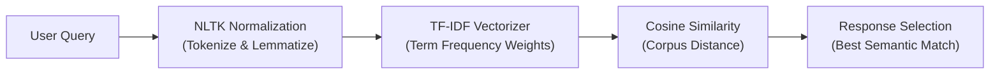

# JansenAI — Classical NLP Conversational Agent

A conversational chatbot in Python utilizing **Natural Language Processing (NLP)**, **TF-IDF Vectorization**, and **Cosine Similarity** for semantic response retrieval.

JansenAI parses user queries, applies linguistic normalization and lemmatization via NLTK, and computes vector similarity across a knowledge corpus (`chatbot.txt`) to surface relevant responses in real time.

---

## Architecture & Methodology



1. **Text Preprocessing & Normalization**:
   - Word and sentence tokenization using `nltk.sent_tokenize` and `nltk.word_tokenize`.
   - Lemmatization via `WordNetLemmatizer` with punctuation stripping and case normalization.
2. **Feature Representation**:
   - Scikit-Learn `TfidfVectorizer` mapping queries and corpus entries into a shared vector space.
3. **Similarity & Retrieval**:
   - Cosine similarity matrix evaluation to rank corpus responses.
   - Rule-based greeting detection and graceful fallback handling for out-of-domain queries.

---

## Project Structure

```text
JansenAI/
├── jansen.py             # Main CLI chatbot application
├── jansen2.py            # Extended chatbot variant
├── chatbot.txt           # Domain knowledge base and conversation corpus
├── Chatbot.ipynb         # Jupyter Notebook with experiments and evaluation
├── How to Use.txt        # Usage notes
└── README.md             # Project documentation
```

---

## Getting Started

### Prerequisites

- Python 3.9+
- Core dependencies:
  ```bash
  pip install numpy scikit-learn nltk
  ```

### NLTK Corpora Download

Download the required linguistic packages in Python:

```python
import nltk
nltk.download('popular', quiet=True)
nltk.download('punkt')
nltk.download('wordnet')
```

### Running the Chatbot

Start the interactive CLI session:

```bash
python jansen.py
```

Type your prompt into the console or type `bye` to exit.

---

## License

This project is open-source and available under the [MIT License](LICENSE).
